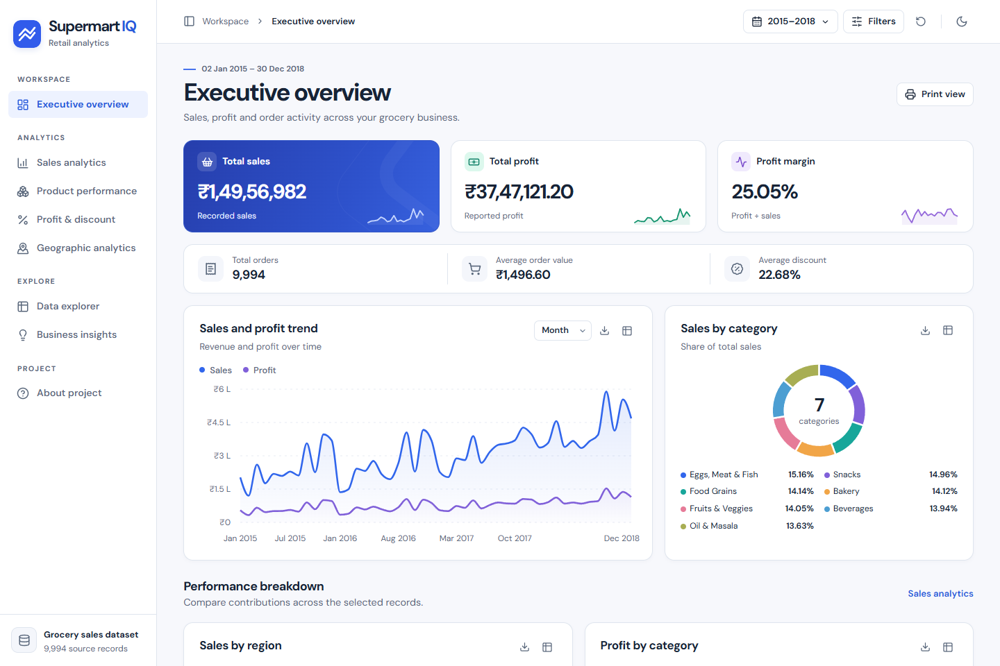

# Supermart Grocery Sales Analytics Dashboard

An interactive retail dashboard for the Sapphire IQ analytics project. Management can follow a sales movement from the executive overview to its category, city and underlying orders. All figures come from the supplied **Supermart Grocery Sales – Retail Analytics Dataset**. The static React app loads validated transactions into the browser and recalculates each view as filters change.



[Mobile screenshot](docs/screenshots/mobile.png) · [Dark theme screenshot](docs/screenshots/dark.png) · [Data audit](docs/DATA_AUDIT.md) · [Data dictionary](docs/DATA_DICTIONARY.md)

## Business questions and project objectives

| Sapphire IQ objective | How to investigate it |
| --- | --- |
| Overall sales performance | Open **Sales analytics**. Compare category shares, regional totals and combined sales/profit trends. Change the period to month, quarter or year and compare sales and profit with the equivalent prior-year period. |
| Product performance | Open **Product performance**. Rank subcategories by sales and profit, compare margins and inspect order-weighted bubbles. The exception table flags groups with above-median sales and below-median margins. |
| Profit and discount | Open **Profit & discount**. Compare category and regional profit, inspect every discount–profit observation and compare record counts and weighted margins across discount bands. |
| Geographic performance | Open **Geographic analytics**. Choose a region, then a state and city. Examine state and city rankings, regional comparisons and high-sales, low-margin cities. |

**Executive overview** combines six KPIs with trend and contribution charts. **Data explorer** supports text search, sorting, pagination, column selection and filtered CSV downloads. **Business insights** gives a supporting figure, interpretation and recommendation for each finding. **About project** describes the full source and methods.

## Full-dataset findings

| Metric | Verified result |
| --- | ---: |
| Total sales | ₹1,49,56,982 |
| Total profit | ₹37,47,121.20 |
| Profit margin | 25.05% |
| Distinct orders | 9,994 |
| Average order value | ₹1,496.60 |
| Average discount | 22.68% |

- **Eggs, Meat & Fish** leads category sales at ₹22,67,401, or 15.16% of total sales. **Snacks** leads category profit at ₹5,68,178.85.
- **West** leads regional sales at ₹47,98,743. **Kanyakumari** leads city sales at ₹7,06,764.
- **September 2018** has the highest monthly sales at ₹5,89,384 under the documented date convention.
- The full dataset’s record-level Pearson correlation between discount and rupee profit is approximately **0.000017**. There is little linear association across these records. The analysis cannot establish a causal discount effect.

## Using the dashboard

Open **Filters** for category, subcategory, region, state and city. Open the **2015–2018** year range in the toolbar. Drag the two handles or choose **From year** and **Through year** to include every record in that span. Use **From month** and **Through month** to narrow the endpoints within those years. Both selected months are included. Choose the same year and month at both ends for a single month. **All years** restores the full reporting period and keeps other filters. Active chips can be removed individually. The reset icon clears every global filter. Changes carry across page navigation. Select a parent dimension to update its child options.

Use the table icon on a chart for exact values and the download icon for a PNG. **Print view** opens the system print dialog, including its Save as PDF destination. Data explorer exports all matching rows in the chosen sort order, using visible columns. Exported dates use ISO and exported discount fractions retain their original numerical scale. The theme preference persists on the device.

## Calculation methods

- Sales and profit sum the recorded amounts. Profit margin equals summed profit divided by summed sales. Monetary aggregations use rounded paise.
- Orders count distinct order IDs, including when an order spans multiple rows. Average order value divides sales by distinct orders. Average discount is the arithmetic mean of the record-level fractions, displayed as a percentage.
- Periods use calendar boundaries. Trend points represent periods with matching records. A partial month contains only the matching dates. Overview sparklines show the most recent 18 observed months, or fewer for shorter selections.
- High-sales, low-margin groups must exceed the unweighted median of group sales and fall strictly below the unweighted median of group margins among the selected peers. Ties at a threshold are excluded.
- Discount bands include their upper endpoint. The last band covers all discounts above 20%. A populated band’s margin equals its total profit divided by its total sales. Empty bands have zero records and are omitted from the margin chart.
- Year-over-year growth divides the change by the absolute prior-year value. The full-data view compares the latest year through its last observed date with the same dates one year earlier. A selected year range overrides that interval and is bounded by the available source dates. Insufficient date coverage, empty comparisons and zero baselines produce **N/A**.

## Data and limitations

The supplied CSV has 11 columns and 9,994 records spanning 2 January 2015 to 30 December 2018. It covers 7 categories, 23 subcategories, 5 source regions, 24 cities and one state, **Tamil Nadu**. The preprocessing audit found zero missing values, duplicate records, duplicate order IDs, invalid dates, invalid discount fractions or negative sales/profits in this file.

The source has two date conventions. The 5,952 slash dates are month/day/year, evidenced by day values of 13–31. The 4,042 hyphen dates follow the brief’s day/month/year convention. Both leading fields of every hyphen date are at most 12. An alternative interpretation changes period-based results.

The finest product dimension is subcategory. All 24 cities occur in multiple source regions. North contains only one transaction. The geographic views use the region assigned on each row and display ranked charts.

Customer names are replaced before export with consistent aliases. The explorer hides that column by default. Published static assets expose every processed transaction, including order IDs and linkable aliases. Confirm the dataset’s redistribution rights and acceptable disclosure before publishing. The private CSV and alias mapping are excluded from the project.


## Stack and structure

React, TypeScript, Vite, React Router, Tailwind CSS, Recharts and Lucide React power the interface. Pandas handles preprocessing. Vitest and React Testing Library cover calculations and table behavior. The order-level scatter uses a high-resolution canvas to draw all records without a separate DOM element for every point.

```text
public/data/         Validated transactions and machine-readable audit
scripts/             Pandas pipeline and Python regression tests
src/analytics.ts     Filtering, aggregation, ranking and statistics
src/insights.ts      Findings and recommendations
src/App.tsx          Navigation, filter controls, theme and data loading
src/AnalyticsPages.tsx  Executive and analytical views
src/Charts.tsx       Charts, tooltips, chart tables and PNG downloads
src/Comparison.tsx   Matched prior-year comparison
src/Explorer.tsx     Record-level search, sort, columns and CSV export
src/tests/           Vitest tests and independent Pandas control fixtures
docs/                Data dictionary, audit and real browser screenshots
vercel.json          Production build and client-side routing
```


## Verification and future work

The delivered build passed TypeScript compilation, the Vite production build, all 21 Vitest cases and all three Python regression tests. Chrome exercised 40 route-and-width combinations against the production build. The checks detected zero page exceptions or browser-console errors. The Beverages/South selection returned 227 records, ₹3,44,666 in sales and ₹84,058.78 in profit.

The JavaScript suite reconciles all six KPIs with Pandas, including the intersection of category and region and an inclusive date range. It also exercises shared order IDs, edge cases, median thresholds, correlation and the explorer. The Python tests check mixed date parsing, source preservation, aliases and invalid inputs.

After `npm run build`, run `npm run test:browser` with Chrome installed. For Microsoft Edge, set `BROWSER_CHANNEL` to `msedge`. The browser suite starts its own local production preview, checks all eight routes at 1920, 1366, 1024, 768 and 390 pixels, and exercises filters, date ranges, drill-downs, downloads, print output, theme persistence and year-over-year figures. It fails on page exceptions, console errors, zero-size chart containers or horizontal page overflow. To refresh the three README screenshots, run `npm run test:browser -- --screenshots`.

Future extensions would benefit from additional source fields. A product identifier would allow SKU rankings, and quantity and unit cost would support price–volume analysis. An authoritative date specification would resolve the remaining ambiguity in monthly reporting.

